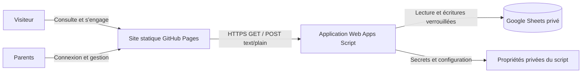
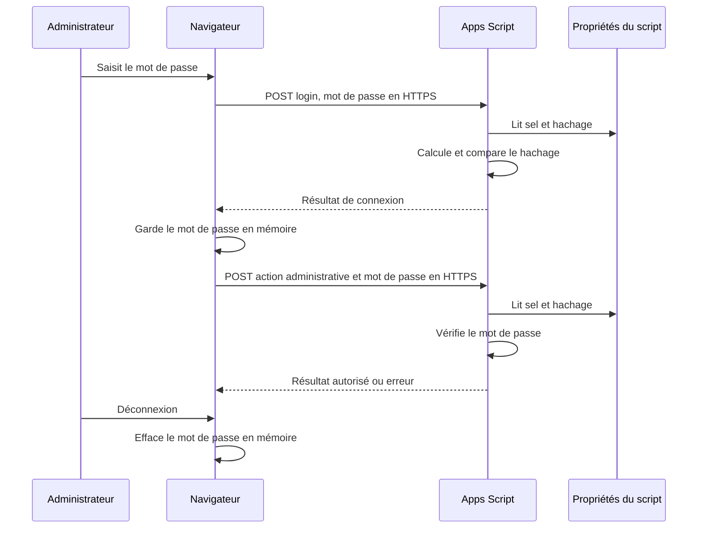

# Fonctionnement

## Parcours

Le visiteur consulte les cadeaux, filtre par catégorie ou recherche un texte, puis choisit une participation ou, si le cadeau n'a reçu aucun engagement, une réservation entière. Il saisit un nom d'affichage. Après une réservation confirmée, le lien d'achat est proposé s'il est renseigné. Le site enregistre une intention ; le visiteur réalise l'achat sur le site du vendeur ou convient des modalités directement avec les parents. Le site ne collecte aucune coordonnée bancaire et ne confirme aucun paiement.

Le total et le reste à financer sont visibles publiquement, pas les noms. Un cadeau réservé ou complètement financé n'accepte plus d'engagement. Les visiteurs ne peuvent pas annuler eux-mêmes : les parents peuvent supprimer un engagement après vérification. La suppression d'un cadeau avec des engagements est bloquée, tout comme un prix inférieur au total engagé ou un changement de prix d'un cadeau réservé.

Les parents se connectent pour ajouter ou modifier un cadeau, supprimer un cadeau sans engagement, voir les noms et montants, ou supprimer un engagement. Dans « Personnaliser », ils modifient le titre et le texte d'accueil et créent, renomment ou suppriment les catégories. Renommer une catégorie modifie tous les cadeaux associés ; la suppression exige d'abord leur réaffectation. Les cadeaux peuvent rester sans catégorie. Les images et liens acceptent uniquement HTTP ou HTTPS. Les montants sont stockés en centimes et affichés en euros.

## Authentification

Le mot de passe n'est pas inscrit dans les fichiers du site ni transformé en hachage côté navigateur. Il reste dans la mémoire de l'onglet pendant l'administration, sans `localStorage`, URL ou cookie ; le rechargement et la déconnexion l'effacent. Aucun JWT ou autre jeton n'est émis. Changer le mot de passe rend immédiatement l'ancien inutilisable, même dans un onglet encore ouvert. Les appels utilisent `text/plain` pour éviter le prévol CORS d'un POST JSON, puis Apps Script retourne du JSON. Ne pas enregistrer les corps de ces requêtes dans des journaux.

## Données et exploitation

- `Gifts` : identifiant, nom, description, catégorie, prix en centimes, URL d'image, URL du produit, date de création.
- `Contributions` : identifiant, identifiant du cadeau, nom d'affichage, type, montant en centimes, date de création.
- `Categories` : identifiant et nom de chaque catégorie ; les cadeaux conservent le nom associé.
- `Settings` : clés et valeurs du titre et du texte d'accueil, publics sur le site.
- Ne pas trier, modifier ou supprimer les colonnes d'en-tête. Les modifications manuelles du classeur contournent les validations et le verrou ; privilégier l'interface.
- Les personnes ayant accès au classeur ou au projet Apps Script peuvent consulter les données et propriétés. Limiter les éditeurs, sauvegarder le classeur, définir une durée de conservation et supprimer les noms lorsqu'ils ne sont plus nécessaires.
- Les appels publics ne sont pas protégés contre l'abus et les tentatives de mot de passe ne sont pas limitées de manière robuste. Voir l'ADR avant publication. Les pages, les liens d'image et de produits ainsi que les polices externes transmettent des informations de connexion à leurs fournisseurs.